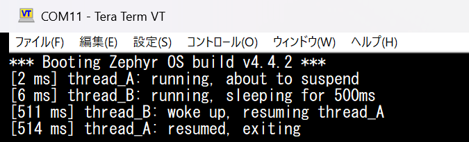

## Introduction
前回の[Zephyr入門 (3)](https://h4rutank.github.io/electronics/2026/11/05/zephyr-3.html)では、ハードウェアの構成を記述する**Devicetree**を学んだ。<br>
今回は、[Zephyr RTOS Cookbook](https://www.oreilly.com/library/view/zephyr-rtos-cookbook/9781807429171/)の第6章をベースに、マルチスレッドについて学ぶ。<br>
- スレッドの作り方
- スレッドのスケジューリング
- セマフォ、メッセージキュー、FIFO

<br><br>

環境は[Zephyr入門 (1)](https://h4rutank.github.io/electronics/2026/10/31/zephyr-1.html)と同じ。<br>
- Hardware: [LP-EM-CC2340R53](https://www.ti.com/tool/ja-jp/LP-EM-CC2340R53)、[LP-XDS110ET](https://www.ti.com/tool/LP-XDS110ET)
- Software: Windows 11、Zephyr v4.4.2、Zephyr SDK 1.0.1、VS Code + Workbench for Zephyr、UniFlash、Tera Term

<br><br>

---
## 1. スレッドの機能
スレッドは、1つの仕事を受けもつ独立した処理の単位である。<br>
仕事ごとにスレッドを作り、RTOSのスケジューラがスレッドを切り替えながらCPUで実行する。<br><br>

たとえば、「ボタンが押されるのを待つ処理」と、「LEDを500 msごとに点滅させる処理」を`while`ループで順番に実行するとする。<br>
このとき、ボタンを待っている間はLEDの点滅が止まる。逆に、点滅の待ち時間の間はボタンの入力を見逃してしまう。<br>
2つの処理を別々のスレッドに分けると、一方のスレッドが暇な時間にもう一方の処理を実行できる（参考: [Scheduling](https://docs.zephyrproject.org/4.4.2/kernel/services/scheduling/index.html)）。

<br><br>

この節で説明する5つの機能は、以下の通り。<br>
スレッドに関連する関数は、`C:\zephyr-ws\deps\zephyr\include\zephyr\kernel.h`で確認できる。<br>

| 機能 | 役割 | 公式ドキュメント | 節 |
|-|-|-|-|
| スレッドの作成 | 並行して動く処理を作る | [Threads](https://docs.zephyrproject.org/4.4.2/kernel/services/threads/index.html) | 1.1 |
| スリープ、サスペンド | スレッドを一定時間スリープさせる、または、起こされるまでサスペンドさせる | [Threads](https://docs.zephyrproject.org/4.4.2/kernel/services/threads/index.html)、[Kernel Timing](https://docs.zephyrproject.org/4.4.2/kernel/services/timing/clocks.html) | 1.2 |
| セマフォ | スレッド間で「処理が終わった」などの合図を送る | [Semaphores](https://docs.zephyrproject.org/4.4.2/kernel/services/synchronization/semaphores.html) | 1.3 |
| メッセージキュー | データのコピーを渡す | [Message Queues](https://docs.zephyrproject.org/4.4.2/kernel/services/data_passing/message_queues.html) | 1.4 |
| FIFO | データへのポインタを渡す | [FIFOs](https://docs.zephyrproject.org/4.4.2/kernel/services/data_passing/fifos.html) | 1.5 |

<br>

### 1.1. スレッドの作成
スレッドの作り方は2通りある。<br>

| 関数 | 作成のタイミング | 用途 |
|-|-|-|
| `k_thread_create()` | 実行中（`main()`などから呼ぶ） | 必要になってから作るスレッド |
| `K_THREAD_DEFINE()` | ビルド時に用意され、起動時に自動で開始する | ずっと存在するスレッド（センサの監視、通信の受信など） |

<br>

`k_thread_create()`は、スタックと管理用の構造体を、自分で用意して渡す。<br>

```c
K_THREAD_STACK_DEFINE(my_stack, 1024);
static struct k_thread my_thread_data;

static void my_entry(void *p1, void *p2, void *p3)
{
	/* スレッドの処理 */
}

/* main()などから */
k_tid_t tid = k_thread_create(&my_thread_data, my_stack,
			      K_THREAD_STACK_SIZEOF(my_stack),
			      my_entry, NULL, NULL, NULL,
			      2, 0, K_NO_WAIT);
```

<br>

`K_THREAD_DEFINE()`は、スタックと構造体を、マクロが用意する。<br>

```c
K_THREAD_DEFINE(my_tid, 1024, my_entry, NULL, NULL, NULL, 10, 0, 0);
```

<br>

引数の意味は、以下の通り。<br>

| 引数 | 意味 |
|-|-|
| `K_THREAD_STACK_DEFINE(name, size)` | スタック用のメモリを、`size`バイト用意する |
| `entry` | スレッドが実行する関数。引数は`void *`が3つ（`p1`、`p2`、`p3`） |
| `p1`、`p2`、`p3` | `entry`に渡す引数。使わなければ`NULL` |
| `prio`（`k_thread_create()`の8番目、`K_THREAD_DEFINE()`の7番目） | 優先度。数字が小さいほど高い |
| `options` | スレッドのオプション。使わなければ`0` |
| 最後の引数（`k_thread_create()`の`delay`） | 開始までの待ち時間。`K_NO_WAIT`は「すぐ動かせる状態にする」 |
| 最後の引数（`K_THREAD_DEFINE()`の`delay`） | 開始までの待ち時間（ミリ秒）。`0`は待たない |

<br>

`k_thread_create()`の戻り値`k_tid_t`は、スレッドのIDである。<br>
このIDは、`k_thread_suspend()`などの引数に使う。<br>
`K_THREAD_DEFINE()`の第1引数`name`は、同じ名前の`k_tid_t`の定数になる。<br><br>

### 1.2. スレッドのスリープとサスペンド
スレッドの実行を止める方法は2つある。<br>

| 関数 | 止まる時間 | 起こす方法 | 止まっている間のCPU占有 |
|-|-|-|-|
| `k_sleep(timeout)` | 指定した時間だけ | 時間が来たら自動で | CPUを使わない |
| `k_thread_suspend(tid)` | 誰かが`k_thread_resume()`を呼ぶまで | 別のスレッドが`k_thread_resume(tid)`で起こす | CPUを使わない |

<br>

`k_sleep()`は、呼んだスレッド自身を指定した時間だけスリープさせる。以下のコードは、スレッドを500 msスリープさせる。<br>

```c
k_sleep(K_MSEC(500));
```

<br>

`k_thread_suspend(tid)`は、`tid`で指定したスレッドをサスペンドさせる。自分自身をサスペンドするときは、`k_current_get()`で自分のIDを取り出して渡す。<br>
サスペンドしたスレッドは、`k_thread_resume(tid)`を呼ぶまで起きない。<br>

```c
k_thread_suspend(k_current_get());   /* 自分をサスペンドさせる */
k_thread_resume(tid);                /* 別のスレッドから起こす */
```

<br><br>

### 1.3. セマフォ
セマフォは、カーネルが管理する数のカウンタで、データは渡さずに、「終わった」という合図だけを送る（参考: [Semaphores](https://docs.zephyrproject.org/4.4.2/kernel/services/synchronization/semaphores.html)）。<br>

| 関数 | 意味 |
|-|-|
| `K_SEM_DEFINE(name, initial_count, count_limit)` | セマフォを定義する。カウンタの初期値と、上限を指定する |
| `k_sem_take(&sem, timeout)` | カウンタが1以上なら、1減らして、すぐ進む。0なら、増えるまで待つ。戻り値は、成功が0、待たずに返ったときが`-EBUSY`、時間切れが`-EAGAIN` |
| `k_sem_give(&sem)` | カウンタを1増やす。待っているスレッドがいれば、1つを起こす |

<br>

```c
K_SEM_DEFINE(sync_sem, 0, 1);

/* 待つ側のスレッド */
k_sem_take(&sync_sem, K_FOREVER);

/* 合図を送る側のスレッド */
k_sem_give(&sync_sem);
```

<br>

初期値が0なので、最初に`k_sem_take()`したスレッドは、`k_sem_give()`されるまで待たされる。<br><br>

### 1.4. メッセージキュー
メッセージキューは、スレッド間でデータを渡す仕組みである（参考: [Message Queues](https://docs.zephyrproject.org/4.4.2/kernel/services/data_passing/message_queues.html)）。<br>
たとえば、グローバル変数を複数のスレッドから直接読み書きすると、書き込みの途中で読まれることがある。一方、キューを使うと、カーネルが受け渡しを管理するので、その心配がない。<br>

| 関数 | 意味 |
|-|-|
| `K_MSGQ_DEFINE(q_name, q_msg_size, q_max_msgs, q_align)` | メッセージキューを定義する。`q_msg_size`が1件のバイト数、`q_max_msgs`が最大件数、`q_align`がバッファの境界を指定する |
| `k_msgq_put(&q, &data, timeout)` | `data`の内容をキューの末尾にコピーする。戻り値は、成功が0、満杯で待たずに返ったときが`-ENOMSG`、時間切れが`-EAGAIN` |
| `k_msgq_get(&q, &data, timeout)` | キューの先頭から`data`へコピーして取り出す。空ならデータが来るまで待つ |

<br>

```c
struct my_msg {
	int a;
	int b;
};

K_MSGQ_DEFINE(my_msgq, sizeof(struct my_msg), 3, 4);

/* 送る側 */
struct my_msg msg = { .a = 42, .b = 100 };
k_msgq_put(&my_msgq, &msg, K_NO_WAIT);

/* 受ける側 */
struct my_msg rx;
k_msgq_get(&my_msgq, &rx, K_FOREVER);
```

<br><br>

### 1.5. FIFO
FIFOは、データそのものではなく**データへのポインタ**を渡す仕組みである（参考: [FIFOs](https://docs.zephyrproject.org/4.4.2/kernel/services/data_passing/fifos.html)）。<br>
大きなデータや、色々な大きさのデータを、コピーせずに渡せる。<br>

| 関数 | 意味 |
|-|-|
| `K_FIFO_DEFINE(name)` | FIFOを定義する |
| `k_fifo_put(&fifo, data)` | `data`のポインタをFIFOの末尾に入れる |
| `k_fifo_get(&fifo, timeout)` | 先頭のポインタを取り出す。時間内に来なければ`NULL`を返す |

<br>

FIFOに入れるデータには、2つの決まりがある。<br>

- データは、ワード境界に置く
- データの先頭の1ワードは、カーネルが使う。そのため、構造体の先頭に`void *reserved;`のような、使わないメンバを置く

<br>

また、`k_fifo_put()`で渡したデータのメモリは、送る側が確保して、受ける側が解放する。<br>
たとえば、送る側が`k_malloc()`で確保して、受ける側が`k_free()`で解放する。この場合は、`prj.conf`に、ヒープの大きさ（`CONFIG_HEAP_MEM_POOL_SIZE`）を書く必要がある。今回の`.config`では、既定値が0だった。<br>

```c
struct my_msg {
	void *reserved;   /* 先頭の1ワードは、カーネルが使う */
	int a;
	int b;
};

K_FIFO_DEFINE(my_fifo);

/* 送る側 */
struct my_msg *msg = k_malloc(sizeof(struct my_msg));
msg->a = 42;
msg->b = 100;
k_fifo_put(&my_fifo, msg);

/* 受ける側 */
struct my_msg *rx = k_fifo_get(&my_fifo, K_FOREVER);
k_free(rx);
```

<br>

メッセージキューとFIFOの違いは以下の通り。<br>

| | メッセージキュー | FIFO |
|-|-|-|
| 渡すもの | データのコピー | データへのポインタ |
| 件数の上限 | 定義するときに決める | なし（メモリがある限り） |
| メモリの管理 | キューが持つ | 送る側が確保し、受ける側が解放する |
| 構造体の制約 | なし | 先頭の1ワードを、カーネルが使う |

<br><br>

---
## 2. マルチスレッドでのスリープ動作
1.2節の`k_sleep()`と`k_thread_suspend()`で、スレッドのスリープとサスペンドの動作を確認する。<br>
スレッドを2つ作り、以下のように動かす。<br>

1. スレッドA（優先度2）が、`k_thread_suspend()`で自分自身をサスペンドする。
2. スレッドB（優先度10）が、`k_sleep()`で500 msスリープする。
3. スレッドBが500 ms後に起きて、`k_thread_resume()`で、スレッドAを起こす。

各スレッドの動作を`printk()`で表示して、処理の順番を観察する。

<br><br>

### 2.1. コードを書く
Workbenchで新規プロジェクト`multithreaded_toto`を、[Zephyr入門 (1)](https://h4rutank.github.io/electronics/2026/10/31/zephyr-1.html)の4.1節と同じ手順で作成して、`src\main.c`を次の内容にする。<br>

```c
#include <zephyr/kernel.h>

#define THREAD_A_STACK_SIZE 1024
#define THREAD_A_PRIORITY   2
#define THREAD_B_STACK_SIZE 1024
#define THREAD_B_PRIORITY   10

K_THREAD_STACK_DEFINE(thread_a_stack, THREAD_A_STACK_SIZE);
static struct k_thread thread_a_data;
k_tid_t thread_a_id;

static void thread_a_entry(void *p1, void *p2, void *p3)
{
	printk("[%u ms] thread_A: running, about to suspend\n", k_uptime_get_32());
	k_thread_suspend(k_current_get());
	printk("[%u ms] thread_A: resumed, exiting\n", k_uptime_get_32());
}

static void thread_b_entry(void *p1, void *p2, void *p3)
{
	printk("[%u ms] thread_B: running, sleeping for 500ms\n", k_uptime_get_32());
	k_sleep(K_MSEC(500));
	printk("[%u ms] thread_B: woke up, resuming thread_A\n", k_uptime_get_32());
	k_thread_resume(thread_a_id);
}

K_THREAD_DEFINE(thread_b_id, THREAD_B_STACK_SIZE, thread_b_entry, NULL, NULL, NULL,
		THREAD_B_PRIORITY, 0, 0);

int main(void)
{
	thread_a_id = k_thread_create(&thread_a_data, thread_a_stack,
				      K_THREAD_STACK_SIZEOF(thread_a_stack),
				      thread_a_entry, NULL, NULL, NULL,
				      THREAD_A_PRIORITY, 0, K_NO_WAIT);
	return 0;
}
```
{: data-file="multithreaded_toto/src/main.c"}

<br>

このコードは、次のことをしている。<br>

| 関数 | 意味 |
|-|-|
| `k_thread_create(...)`（`main()`の中） | スレッドA（優先度2）を、実行中に作る |
| `K_THREAD_DEFINE(thread_b_id, ...)` | スレッドB（優先度10）を、ビルド時に用意して、起動時に自動で開始する |
| `k_uptime_get_32()` | 起動からの経過時間（ミリ秒）。表示の頭に付けて、待ち時間を測る |
| `k_thread_suspend(k_current_get())` | スレッドAが、自分自身をサスペンドする |
| `k_sleep(K_MSEC(500))` | スレッドBが、500 msスリープする |
| `k_thread_resume(thread_a_id)` | スレッドBが、スレッドAを起こす |

<br><br>

### 2.2. 結果を確認する
**Build**して、UniFlashで書き込み、Tera Termでシリアルモニタを表示する。<br>

<br>

表示の順番と時刻は、次のようになった。<br>

| 順 | 表示 | 時刻 |
|-|-|-|
| 1 | `thread_A: running, about to suspend` | 2 ms |
| 2 | `thread_B: running, sleeping for 500ms` | 6 ms |
| 3 | `thread_B: woke up, resuming thread_A` | 511 ms |
| 4 | `thread_A: resumed, exiting` | 514 ms |

<br>

この順番になる理由は、以下の通りである。<br>

1. 起動すると、`main()`を動かすスレッド（優先度0）と、スレッドB（優先度10）が、動ける状態になる。数字の小さい`main()`が、先に動く
2. `main()`が、スレッドA（優先度2）を作る。Aは、`main()`より優先度が低いので、`main()`はそのまま最後まで動いて終わる
3. 残ったAとBのうち、優先度の高い（数字の小さい）Aが先に動いて、1行目を表示する。そして、自分自身をサスペンドする
4. Bが動いて、2行目を表示して、500 msスリープする。このとき、AもBも動けないので、CPUは空き状態（idle）になる
5. 500 ms後に、Bが起きて、3行目を表示して、Aを起こす。Aの方が優先度が高いので、Bの`k_thread_resume()`の直後に、Aが割り込んで、4行目を表示する

<br>

Bがスリープした時刻（6 ms）から起きた時刻（511 ms）までは、505 msだった。500 msとの差の5 msは、2行目の表示（約46文字を、115200 bpsで送る時間は、約4 ms）にかかった時間だと考えられる。

<br><br>

---
## Summary
マルチスレッドの文法と、スリープとサスペンドの動作を学んだ。<br>

- スレッドの作成は、`k_thread_create()`（実行中）か`K_THREAD_DEFINE()`（ビルド時）
- `k_sleep()`は指定時間のスリープ、`k_thread_suspend()`は`k_thread_resume()`で起こされるまでサスペンド
- 合図はセマフォ、データのコピーはメッセージキュー、データへのポインタはFIFOで渡す

<br>

次回は、CC2340のBLE機能の使い方を学ぶ。<br><br>
