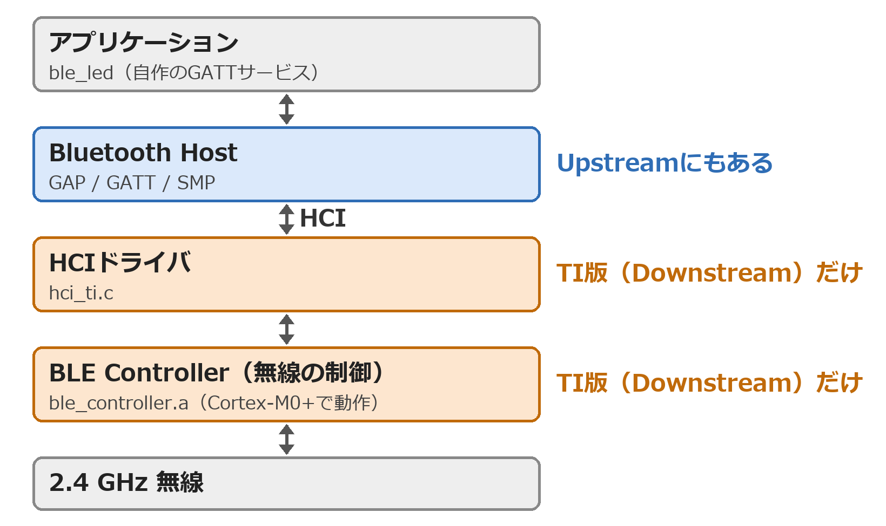
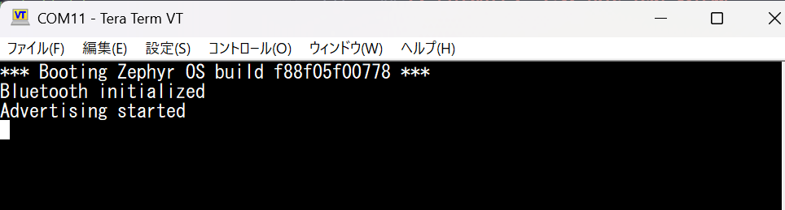
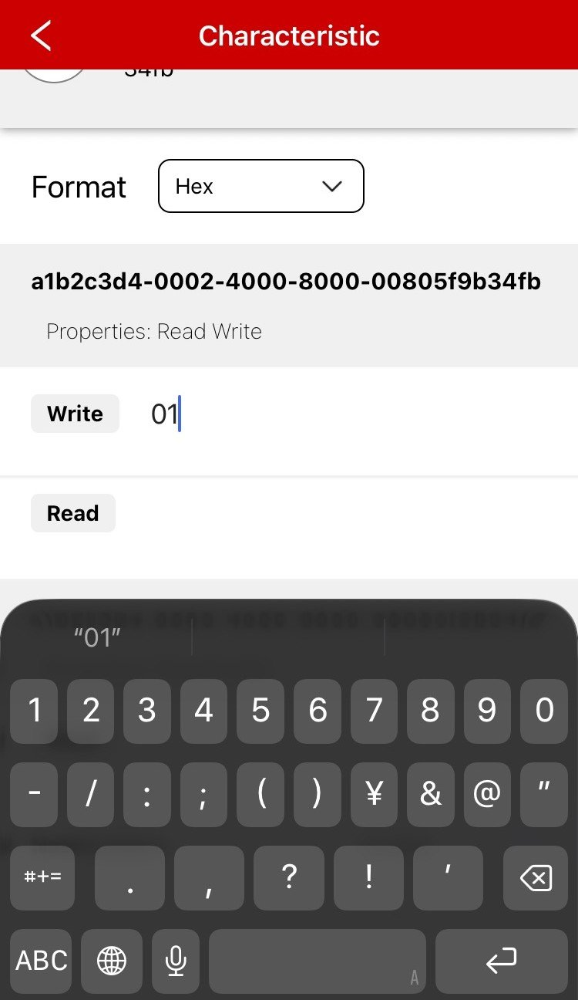
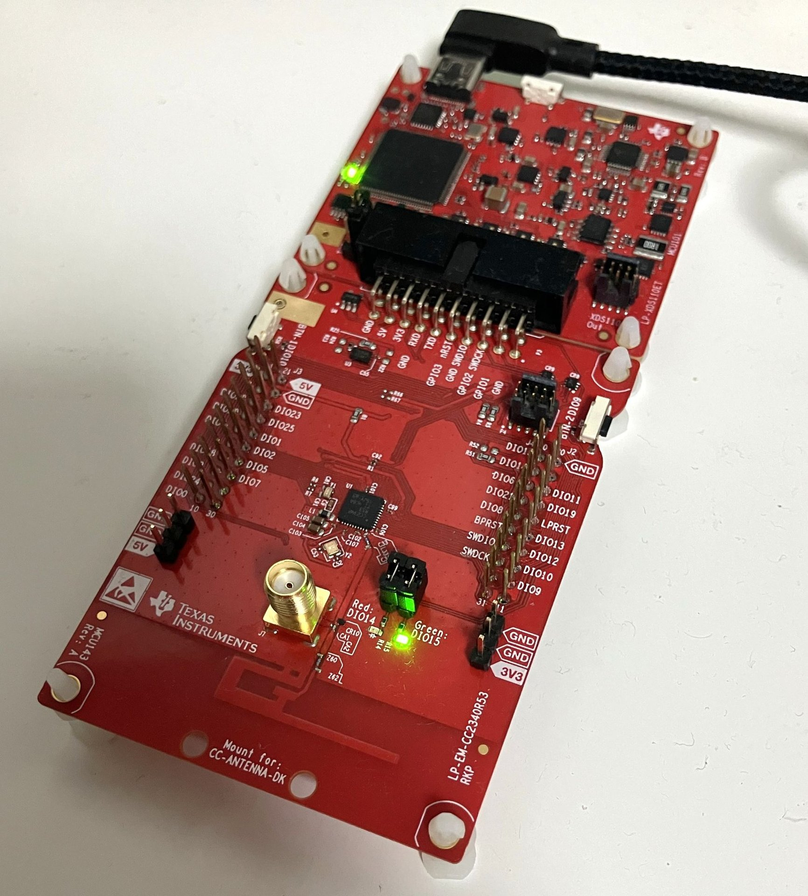

## Introduction
前回の[Zephyr入門 (4)](https://h4rutank.github.io/electronics/2026/11/08/zephyr-4.html)では、マルチスレッドを学んだ。<br>
今回は、CC2340R53で**Bluetooth LE（BLE）**を動かして、自作の**GATTサービス**を作る。<br><br>

環境は[Zephyr入門 (1)](https://h4rutank.github.io/electronics/2026/10/31/zephyr-1.html)とほとんど変わらないが、Zephyr本体だけ今回はTI版Downstreamを使う。<br>
- Hardware: [LP-EM-CC2340R53](https://www.ti.com/tool/ja-jp/LP-EM-CC2340R53)、[LP-XDS110ET](https://www.ti.com/tool/LP-XDS110ET)、スマートフォン
- Software: Windows 11、**Zephyr v4.4.0-ti-next**、Zephyr SDK 1.0.1、VS Code + Workbench for Zephyr、UniFlash、Tera Term、スマートフォンアプリ SimpleLink Connect

<br><br>

### UpstreamとDownstream
第1回～第4回までに使ってきたZephyr v4.4.2は、**Upstream**と呼ばれる。Zephyr Projectが管理している本家のリポジトリ（[zephyrproject-rtos/zephyr](https://github.com/zephyrproject-rtos/zephyr)）である。<br>
一方、**Downstream**は本家から枝分かれして、チップベンダーが自社チップ向けの変更を加えたリポジトリ。
<br><br>

CC2340のBLEはUpstreamでは動かないので、TIのDownstream（[TexasInstruments/zephyr](https://github.com/TexasInstruments/zephyr)）の`v4.4.0-ti-next`を使用する。<br>
BLEのスタックは、Host（GAP、GATT、SMP）とController（無線の制御）という2層のアーキテクチャに分かれている。Host側はUpstreamと同じコードでもよいが、TI製品のBLE無線機能を使うためのドライバ（Controller側）はまだUpstream版で対応していない。そこで、TIのDownstream版のZephyrをもとに開発する。<br>


<br>

<br>

今回使うのは、Zephyr v4.4.0の上にTIの変更を載せた開発中のブランチ`v4.4.0-ti-next`である。
<br><br>

---
## 1. GATTサービスとは
BLE機器どうしがデータをやり取りする際の「データをどう並べて、どう読み書きするか」の決まりがGATT（Generic Attribute Profile）である。<br>
この節では、Core Specification v6.0（以下、Core Spec）をもとに構造を整理する。

<br><br>

### 1.1. サーバーとクライアント
GATTでは、機器が2つの役割に分かれる。<br>

| 役割 | 意味 | 今回の機器 |
|-|-|-|
| GATTサーバー | 値（属性）を持つ側 | CC2340R53 |
| GATTクライアント | 値を読み書きする側 | スマートフォン |

<br>

この役割は、接続の主導権を表すCentral（スマートフォン）とPeripheral（CC2340R53）とは、別の概念である。GATTのサーバーとクライアントは、どちらもCentralにもPeripheralにもなれる。今回は、PeripheralのCC2340R53がサーバーになる、一般的な組み合わせである。<br><br>

GATTは、**ATT（Attribute Protocol）**というプロトコルの上に作られている。<br>
ATTは、サーバーが持つデータ（**属性**。1.2節で説明する）を、クライアントが番号（ハンドル）を指定して読み書きするための、要求と応答のパケットを決めている。<br>
つまり、ATTが「読み書きの仕組み」で、GATTが、その上での「データの並べ方と、ATTを使う手順」である。<br><br>

GATT、ATTと、その下の層の関係は、以下のとおり。<br>

| 層 | 役割 |
|-|-|
| GATT | 属性を「サービス、特性、ディスクリプタ」に整理し、探索、読み書き、通知の手順を決める |
| ATT | 属性を読み書きするパケット（要求と応答）を決める |
| L2CAP | ATTのパケットを運ぶ。ATTは固定のチャネルID 0x0004を使う |

<br><br>

### 1.2. 属性（Attribute）
サーバーが持つデータの最小単位が**属性**で、4つの要素を持つ（Core Spec Vol 3, Part F）。<br>

| 要素 | 意味 |
|-|-|
| ハンドル | 属性の番号（16ビット）。サーバーの中で、属性を1つずつ区別する。ZephyrではBluetoothのスタックが割り当てる |
| タイプ（UUID） | 属性の種類 |
| パーミッション | その属性に許す操作（読み、書き、暗号化が必要か、など）。サーバーの中だけの設定で、電波には出ない |
| 値 | 属性が持つデータ |

<br>

サーバーの属性は、ハンドルの順に1列で並ぶ「属性テーブル」になっている。クライアントは、ハンドルを指定して、値を読み書きする。<br><br>

### 1.3. サービス/特性/ディスクリプタ
1列の属性テーブルを、サービス/特性/ディスクリプタの3階層に整理するのがGATTである（Core Spec Vol 3, Part G, §2.6、§3）。<br>

```text
GATT server (attribute table)
 +-- Service
      +-- Service declaration           (UUID 0x2800)
      +-- Characteristic A
      |    +-- Characteristic declaration   (UUID 0x2803)
      |    +-- Characteristic value         (UUID of A)
      |    +-- Descriptor, e.g. CCC         (UUID 0x2902)
      +-- Characteristic B
           +-- ...
```

<br>

図書館にたとえると、次のようになる。<br>

| BLE | 図書館のたとえ |
|-|-|
| GATTサーバー | 図書館 |
| サービス | ジャンル別のコーナー（例: 「天気」コーナー） |
| 特性 | コーナーに置かれた、1つの資料のセット |
| 属性 | 本1冊 |
| ハンドル | 本の棚番号 |

<br>

1つの特性は、複数の属性で作られる。<br>

| 属性 | UUID | 図書館のたとえ | 中身 |
|-|-|-|-|
| 特性宣言 | 0x2803 | 資料セットの目次カード | プロパティ（できる操作）、値の属性のハンドル、値のUUID |
| 特性の値 | その特性のUUID | 資料セットの本体 | 実際のデータ |
| ディスクリプタ | 種類による | 付属のメモ | 補足情報（例: 通知の設定CCC） |

<br><br>

サービスの先頭には、サービス宣言（0x2800）の属性が置かれる。次のサービス宣言が出てくるまでの属性が、そのサービスに属する。<br>
スマートフォンは、接続すると最初に、サービス宣言と特性宣言を順に読んで、サーバーの属性テーブルの地図を作る（サービス探索）。<br>
この探索で使う手順とATTのパケットは、以下のとおり（すべて Core Spec Vol 3, Part G の節）。<br>

| 探索するもの | GATTの手順 | ATTのパケット |
|-|-|-|
| サービス | Primary Service Discovery（§4.4） | ATT_READ_BY_GROUP_TYPE_REQ / RSP |
| 特性 | Characteristic Discovery（§4.6） | ATT_READ_BY_TYPE_REQ / RSP |
| ディスクリプタ | Characteristic Descriptor Discovery（§4.7） | ATT_FIND_INFORMATION_REQ / RSP |

<br><br>

---
## 2. 自作GATTサービス（ble_led）の作成
前節を踏まえて、次のGATTサービスを作る。<br>

| 特性 | UUID（先頭の一部） | プロパティ | 動き |
|-|-|-|-|
| LED | `055ec3cd-…` | Read、Write | スマートフォンからの入力次第で、緑LED（DIO15）を点灯 |
| ボタン | `055ec3ce-…` | Read、Notify | SW1（DIO10）を押すと、スマートフォンへ通知する |

<br>

サービスと特性の種類は、**UUID**で区別する。Bluetooth SIGが決めたサービス（バッテリー、心拍など）は、SIGが割り当てた短い16ビットのUUIDを使い、自作のサービスには、自分で決めた128ビットのUUIDを使う。<br>
今回のサービスのUUIDは`055ec3cc-a98d-4b83-af79-ea8eac406215`である。Pythonの`uuid.uuid4()`で生成した、ランダムな128ビットUUID（バージョン4）で、他の機器のUUIDと重なる可能性は、実用上無視できる。特性のUUIDは、サービスのUUIDの先頭32ビットだけを、1ずつ増やした値（`055ec3cd-…`、`055ec3ce-…`）にした。

<br><br>

### 2.1. Downstream版のワークスペースを用意する
Downstream版のZephyrは、第1回のワークスペース`C:\zephyr-ws`（Upstream v4.4.2）とは別に、`C:\zephyr-ti-ws`として用意する。<br>
第1回と同じく、最初の取得だけを、PowerShellで行う。<br><br>

`C:\zephyr-ti-ws\ble_app\west.yml`を、次の内容で作る。<br>

```yaml
manifest:
  remotes:
    - name: ti
      url-base: https://github.com/TexasInstruments
  projects:
    - name: zephyr
      remote: ti
      revision: f88f05f00778719e06a0754e6e396f16f316261d  # v4.4.0-ti-next
      import:
        path-prefix: deps
        name-allowlist:
          - cmsis
          - cmsis_6
          - hal_ti
          - picolibc
          - mbedtls
          - tf-psa-crypto
  self:
    path: ble_app
```
{: data-file="ble_app/west.yml"}

<br>

第1回の`west.yml`との違いは以下のとおりである。<br>

| 項目 | 違い |
|-|-|
| `remote` | TIのGitHub（`TexasInstruments`）になっている。`hal_ti`も、TI版が取得される |
| `revision` | ブランチ名ではなく、動作を確認したコミットのハッシュ。ブランチは中身が日々変わるので、コミットで固定する |
| `name-allowlist` | `mbedtls`と`tf-psa-crypto`が増えている。BLEのホストが暗号に使うので、無いとKconfigの段階で止まる |

<br>

Workbenchはワークスペースの直下の`.venv`を使うので、以下のコマンドで仮想環境の環境構築を行う。<br>

```powershell
cd C:\zephyr-ti-ws; python -m venv .venv; .\.venv\Scripts\Activate.ps1

python -m pip install west
west init -l ble_app
west update --narrow -o=--depth=1
python -m pip install -r deps\zephyr\scripts\requirements.txt
python -m pip install ti-simplelink-crc-tool
```

<br>

取得できたかどうかは、次の2つで確かめる。<br>

```powershell
west list
dir C:\zephyr-ti-ws\deps\modules\hal\ti\simplelink_lpf3\source\ti\ble\lib\m0p\ble_controller.a
```

`west list`に`zephyr`、`hal_ti`などが並び、2つ目のコマンドで`ble_controller.a`が表示されれば、TI版を取得できている。`ble`フォルダが無いときは、Upstreamの`hal_ti`を取得してしまっているので、`west.yml`の`url-base`を見直す。<br><br>

次に、第1回の手順と同じく、Workbenchの**Add West Workspace**で、`C:\zephyr-ti-ws`を**Local folder**として登録する。<br>
**Add Application**のボードの一覧には、`TI SimpleLink CC2340R53 LaunchPad`（`lp_em_cc2340r53`）が出てくる。第1回～第4回まで、R5用のボード定義で代用していたが、これでR53のボードを直接選べる。<br>

<br>


### 2.2. アプリの作成
Workbenchの**Add Application**を選んで、アプリ`ble_led`を作成する。<br>
Boardは`lp_em_cc2340r53`で、Sample Projctは`hello_world`とする。

<br><br>

生成された`prj.conf`の先頭へ次の4行を追加する。<br>
BLEホストの有効化、CC2340をPeripheralとして参加させること、デバイス名、GPIOの使用を定義している。<br>

```text
CONFIG_BT=y
CONFIG_BT_PERIPHERAL=y
CONFIG_BT_DEVICE_NAME="R53-LED"
CONFIG_GPIO=y
```
{: data-file="ble_led/prj.conf（先頭に足す内容）"}

<br>

`src\main.c`は、以下のように書き換える。<br>

```c
/*
 * Copyright (c) 2012-2014 Wind River Systems, Inc.
 *
 * SPDX-License-Identifier: Apache-2.0
 */

#include <zephyr/kernel.h>
#include <zephyr/sys/printk.h>
#include <zephyr/drivers/gpio.h>
#include <zephyr/bluetooth/bluetooth.h>
#include <zephyr/bluetooth/conn.h>
#include <zephyr/bluetooth/gatt.h>
#include <zephyr/bluetooth/uuid.h>

/* 自作サービスの UUID（128 bit。uuid4 で生成）。先頭 32 bit を 1 ずつ変えて、サービスと特性を区別する */
#define SVC_UUID_VAL BT_UUID_128_ENCODE(0x055ec3cc, 0xa98d, 0x4b83, 0xaf79, 0xea8eac406215)

static const struct bt_uuid_128 svc_uuid = BT_UUID_INIT_128(SVC_UUID_VAL);
static const struct bt_uuid_128 led_uuid = BT_UUID_INIT_128(
	BT_UUID_128_ENCODE(0x055ec3cd, 0xa98d, 0x4b83, 0xaf79, 0xea8eac406215));
static const struct bt_uuid_128 btn_uuid = BT_UUID_INIT_128(
	BT_UUID_128_ENCODE(0x055ec3ce, 0xa98d, 0x4b83, 0xaf79, 0xea8eac406215));

static const struct gpio_dt_spec led = GPIO_DT_SPEC_GET(DT_ALIAS(led0), gpios);
static const struct gpio_dt_spec btn = GPIO_DT_SPEC_GET(DT_ALIAS(sw0), gpios);

static uint8_t led_state;
static uint8_t btn_state;

static ssize_t read_led(struct bt_conn *conn, const struct bt_gatt_attr *attr,
			void *buf, uint16_t len, uint16_t offset)
{
	return bt_gatt_attr_read(conn, attr, buf, len, offset, &led_state, sizeof(led_state));
}

static ssize_t write_led(struct bt_conn *conn, const struct bt_gatt_attr *attr,
			 const void *buf, uint16_t len, uint16_t offset, uint8_t flags)
{
	if (offset != 0 || len != 1) {
		return BT_GATT_ERR(BT_ATT_ERR_INVALID_ATTRIBUTE_LEN);
	}

	led_state = (((const uint8_t *)buf)[0] != 0) ? 1 : 0;
	gpio_pin_set_dt(&led, led_state);
	printk("LED -> %u\n", led_state);

	return len;
}

static ssize_t read_btn(struct bt_conn *conn, const struct bt_gatt_attr *attr,
			void *buf, uint16_t len, uint16_t offset)
{
	return bt_gatt_attr_read(conn, attr, buf, len, offset, &btn_state, sizeof(btn_state));
}

BT_GATT_SERVICE_DEFINE(ctl_svc,
	BT_GATT_PRIMARY_SERVICE(&svc_uuid),
	BT_GATT_CHARACTERISTIC(&led_uuid.uuid,
			       BT_GATT_CHRC_READ | BT_GATT_CHRC_WRITE,
			       BT_GATT_PERM_READ | BT_GATT_PERM_WRITE,
			       read_led, write_led, NULL),
	BT_GATT_CHARACTERISTIC(&btn_uuid.uuid,
			       BT_GATT_CHRC_READ | BT_GATT_CHRC_NOTIFY,
			       BT_GATT_PERM_READ,
			       read_btn, NULL, NULL),
	BT_GATT_CCC(NULL, BT_GATT_PERM_READ | BT_GATT_PERM_WRITE),
);

/* ボタンの割り込みから直接 bt_gatt_notify() は呼べないので、ワークに任せる */
static void btn_work_handler(struct k_work *work)
{
	btn_state = gpio_pin_get_dt(&btn) ? 1 : 0;
	printk("Button -> %u\n", btn_state);
	bt_gatt_notify_uuid(NULL, &btn_uuid.uuid, ctl_svc.attrs, &btn_state, sizeof(btn_state));
}

static K_WORK_DEFINE(btn_work, btn_work_handler);
static struct gpio_callback btn_cb;

static void btn_isr(const struct device *dev, struct gpio_callback *cb, uint32_t pins)
{
	k_work_submit(&btn_work);
}

static const struct bt_data ad[] = {
	BT_DATA_BYTES(BT_DATA_FLAGS, (BT_LE_AD_GENERAL | BT_LE_AD_NO_BREDR)),
	BT_DATA_BYTES(BT_DATA_UUID128_ALL, SVC_UUID_VAL),
};

static const struct bt_data sd[] = {
	BT_DATA(BT_DATA_NAME_COMPLETE, CONFIG_BT_DEVICE_NAME, sizeof(CONFIG_BT_DEVICE_NAME) - 1),
};

static void start_advertising(void)
{
	int err = bt_le_adv_start(BT_LE_ADV_CONN_FAST_1, ad, ARRAY_SIZE(ad), sd, ARRAY_SIZE(sd));

	if (err) {
		printk("Advertising failed to start (err %d)\n", err);
		return;
	}
	printk("Advertising started\n");
}

static void connected(struct bt_conn *conn, uint8_t err)
{
	printk(err ? "Connection failed (err 0x%02x)\n" : "Connected\n", err);
}

static void disconnected(struct bt_conn *conn, uint8_t reason)
{
	printk("Disconnected (reason 0x%02x)\n", reason);
}

/* 切断後に接続オブジェクトが解放されたら、再びアドバタイズを始める */
static void recycled(void)
{
	start_advertising();
}

BT_CONN_CB_DEFINE(conn_cb) = {
	.connected = connected,
	.disconnected = disconnected,
	.recycled = recycled,
};

int main(void)
{
	int err;

	if (!gpio_is_ready_dt(&led) || !gpio_is_ready_dt(&btn)) {
		printk("GPIO not ready\n");
		return 0;
	}
	gpio_pin_configure_dt(&led, GPIO_OUTPUT_INACTIVE);
	gpio_pin_configure_dt(&btn, GPIO_INPUT);
	gpio_pin_interrupt_configure_dt(&btn, GPIO_INT_EDGE_BOTH);
	gpio_init_callback(&btn_cb, btn_isr, BIT(btn.pin));
	gpio_add_callback(btn.port, &btn_cb);

	err = bt_enable(NULL);
	if (err) {
		printk("Bluetooth init failed (err %d)\n", err);
		return 0;
	}
	printk("Bluetooth initialized\n");

	start_advertising();
	return 0;
}
```
{: data-file="ble_led/src/main.c"}

<br><br>

#### 1) サービスの定義（BT_GATT_SERVICE_DEFINE）
`BT_GATT_SERVICE_DEFINE`が、1.3節の属性テーブルをビルド時に作る。<br>

| マクロ | 作られる属性 | 設定 |
|-|-|-|
| `BT_GATT_PRIMARY_SERVICE` | サービス宣言 | サービスのUUID |
| `BT_GATT_CHARACTERISTIC`（LED） | 特性宣言と、LEDの値 | プロパティはRead + Write。値には`read_led()`と`write_led()`を割り当てる |
| `BT_GATT_CHARACTERISTIC`（ボタン） | 特性宣言と、ボタンの値 | プロパティはRead + Notify。値には`read_btn()`を割り当てる |
| `BT_GATT_CCC` | ボタンの通知の設定（CCC） | クライアントが書き込めるようにする |

<br>

`BT_GATT_CHARACTERISTIC`は、特性宣言と値の2つの属性を作る。そのため、属性は全部で6個になる。ハンドルは、Bluetoothのスタックが割り当てる。<br><br>

#### 2) 読み書き
`read_led()`、`read_btn()`、`write_led()`は、クライアントが値を読み書きしたときに呼ばれる。<br>
`write_led()`は、書き込まれた値が0以外なら1としてLEDを点灯し、0なら消灯する。書き込まれた長さが1オクテットでないときは、エラーを返す。<br><br>

#### 3) ボタンの通知
**通知**は、サーバーが値の変化を、クライアントの要求を待たずに送る操作である（Core Spec Vol 3, Part G, §4.10）。ただし、クライアントが、ボタンの特性の**CCC**に1を書き込んで、通知を有効にするまでは、何も送られない（同 §3.3.3.3）。<br><br>

SW1を押すと、次の順に処理が進む。<br>

1. 割り込みで`btn_isr()`が呼ばれ、`k_work_submit()`で、処理をワークキューに預ける
2. ワークキューのスレッドで`btn_work_handler()`が動き、ボタンの状態を`bt_gatt_notify_uuid()`で通知する

割り込みの中では、時間のかかるBluetoothのAPIを呼べないので、通知はワークキューに任せている。<br><br>

#### 4) アドバタイズと再接続
アドバタイズデータにはサービスのUUIDを、スキャン応答にはデバイス名`R53-LED`を入れている。<br>
接続されるとアドバタイズは止まるので、切断後に`recycled`のコールバックで、アドバタイズを始め直す。

<br><br>

### 2.3. ビルドと通信動作の確認
Workbenchでビルドして、UniFlashで`zephyr.hex`を書き込み、Tera Termでシリアルモニタの表示を確認する。
<br><br>

<br>

<br>

TIが提供するBLE実験用アプリ**SimpleLink Connect**をスマートフォンにダウンロードして、次の順に操作する。<br>

| 手順 | スマートフォンでの操作 | LP-EM-CC2340R53での動作 | Tera Termの表示 |
|-|-|-|-|
| 1 | デバイス`R53-LED`に接続する | 接続できる | `Connected` |
| 2 | UUIDが`055ec3cc-…`のサービスを開く | | なし |
| 3 | LED（`055ec3cd-…`）に`01`を入力 | **緑LEDが点灯する** | `LED -> 1` |
| 4 | LEDに`00`を入力 | 緑LEDが消灯する | `LED -> 0` |
| 5 | 切断する | 切断される。少しして、再び見つけられる | `Disconnected (reason …)`、続けて`Advertising started` |

<br>

手順3でLEDの特性（`055ec3cd-…`）に`01`を書き込むと、ボードのLED（DIO15）が緑色に点灯する。
BLEの通信が成功していることを実機で確認できた。。<br>

<br>

<br>

<br><br>

### 2.4. ble_ledのメモリ使用量
Workbenchで作ったアプリと同じ構成でビルドすると、FLASHは203,608 B（512 KBの39%）、RAMは38,224 B（64 KBの58%）だった。デバッグ用の設定を外すと、FLASHは182,116 B、RAMは37,768 Bになる。<br><br>

RAMの使い道を、`zephyr.elf`のシンボルから調べた。アプリの変数は約40 Bしかなく、ほとんどはTIのコントローラとZephyrが使っている。<br>

| 分類 | RAM | 割合 | 主な項目 |
|-|-|-|-|
| TIのコントローラとドライバ | 10,212 B | 約27% | コントローラ専用のヒープ6,272 B、ドライバ用タスクのスタック3,008 B |
| Zephyrのカーネル | 9,860 B | 約26% | `main()`と割り込みのスタック各2,048 B、システムヒープ3,140 B、ワークキューのスタック |
| ZephyrのBluetoothホスト | 7,895 B | 約21% | HCIなどのパケット用バッファ5,567 B、ワークキューのスタック |
| 暗号化モジュール | 1,092 B | 約3% | PSA Cryptoの内部データ |

<br>

残りの約9 KBは、小さな変数の集まりである。Zephyr側（カーネル、ホスト、暗号）は合計で約18.8 KB、RAMの約半分を使う。Zephyrは機能ごとにスレッドを持ち、スレッドごとに固定サイズのスタックを確保するので、アプリが何もしなくても一定のRAMが必要になる。スタックやバッファの大きさは、`CONFIG_MAIN_STACK_SIZE`などのKconfigで変えられる。<br><br>

FLASHは、`zephyr.map`を見ると、約107 KBがTI製のコントローラとドライバで、ZephyrはBluetoothホスト（約30 KB）が最大だった。<br><br>

---
## Summary
ZephyrでCC2340R53のBLEを動かして、自作GATTサービスの動作を確認した。<br>

- CC2340のBLEは、Upstreamのv4.4.2では動かない。TI版のDownstream（`v4.4.0-ti-next`）が必要
- GATTは、属性（ハンドル、UUID、パーミッション、値）を、サービス/特性/ディスクリプタの3階層に整理する
- `ble_led`のメモリは、FLASHが約204 KB、RAMが約38 KB。RAM使用量の半分（約19 KB）はZephyrのカーネルとホストが占める

<br><br>
